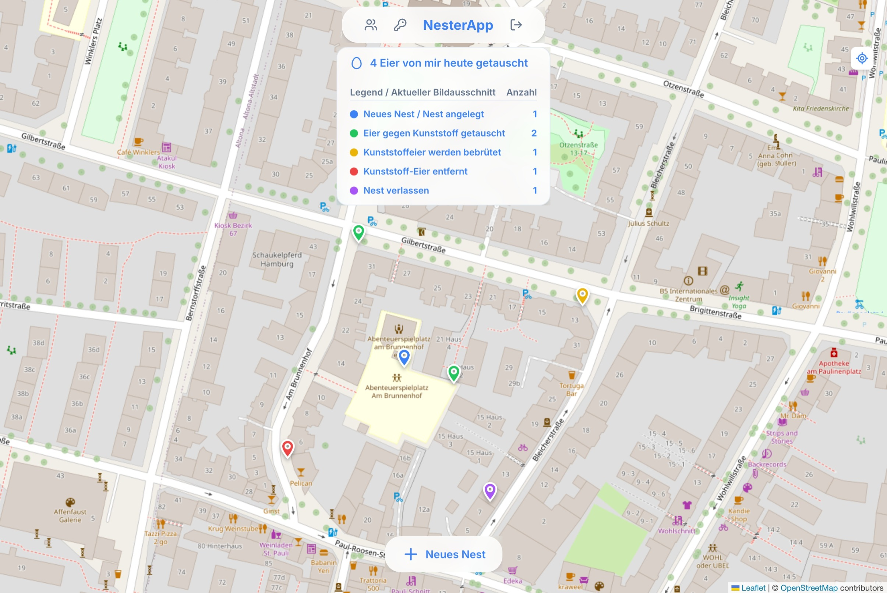
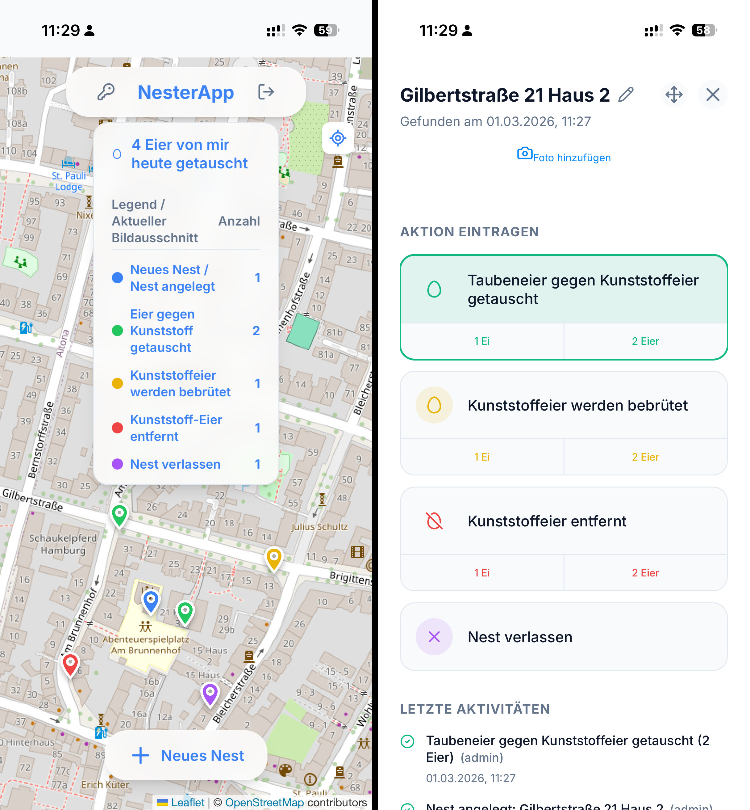

# NesterApp

NesterApp ist eine Open-Source-Webanwendung zur Erfassung und Verwaltung von Taubennestern in Städten. Sie bietet eine interaktive Karte zur Lokalisierung von Nestern, zur Protokollierung von Beobachtungen und zum Hochladen von Fotos mit dem Ziel, das tierschutzgerechte Management städtischer Taubenpopulationen zu unterstützen.

## Screenshots

### Browser



### Mobile



## Funktionen
- **Interaktive Karte**: Ansicht aller registrierten Nester mithilfe von Leaflet (OpenStreetMaps).
- **Indoor- & Parkdeck-Karten**: Detaillierte Gebäude- und Parkdeck-Ebenen mit Etagenfilter (`level`) auf Basis von OpenStreetMap-Daten.
- **Berichterstattung**: Protokollierung von Aktivitäten, Statusaktualisierungen und Fotos für einzelne Nester.
- **Standortverfolgung**: Automatische Benennung basierend auf OpenStreetMap-Einrichtungen oder Straßenadressen.
- **PWA-fähig**: Kann auf Mobilgeräten für die Berichterstattung von unterwegs installiert werden.

## Demo

Eine Live-Demo ist verfügbar unter: **[nester-demo.philip.ps](https://nester-demo.philip.ps)**

> **Hinweis:** Die Demo-Datenbank wird bei jedem Deployment automatisch zurückgesetzt.

| Konto | Benutzername | Passwort | Rolle |
|-------|-------------|----------|-------|
| Demo | `demo@example.com` | `demo123` | Standardbenutzer |

## Erste Schritte

Siehe [INSTALLATION.md](INSTALLATION.md) für Anweisungen zur Einrichtung der lokalen Entwicklungsumgebung und zur Bereitstellung in der Produktion.

## Indoor-Kartendaten (Hamburg)

Für extrem schnelle Antwortzeiten (~5 ms) und die Offline-Fähigkeit der PWA nutzt das Backend einen vorberechneten Datensatz (`backend/data/indoor_hamburg.geojson`), der Indoor-Features, Räume, Parkflächen, Treppen und Aufzüge im Hamburger Stadtgebiet bereitstellt.

### Daten aktualisieren

Der Datensatz kann jederzeit über die Overpass-API (mit automatischem Spiegelserver-Failover) neu generiert werden:

#### Über die CLI (Kommandozeile)
Im Projektverzeichnis:
```bash
php backend/api/indoor.php --refresh
# alternativ:
php backend/api/indoor.php --seed-hamburg
```

#### Über HTTP / cURL (z. B. für Cronjobs)
```bash
curl "https://<deine-domain>/backend/api/indoor.php?action=refresh_hamburg&token=<INDOOR_REFRESH_TOKEN>"
```

> **Hinweis:** Der Secret-Token wird in der `.env`-Datei über `INDOOR_REFRESH_TOKEN` definiert (Beispiel in `.env.example`). Das Skript ruft die aktuellen Daten für Hamburg ab, konvertiert sie in ein bereinigtes GeoJSON-FeatureCollection-Format und aktualisiert die Datei `backend/data/indoor_hamburg.geojson` inklusive `generated_at`-Zeitstempel.

## Mitwirken

Wir freuen uns über Beiträge! Bitte lies [CONTRIBUTING.md](CONTRIBUTING.md) für Richtlinien, wie du helfen kannst.

## Lizenz

Dieses Projekt ist unter der GNU General Public License v3.0 lizenziert - siehe die Datei [LICENSE](LICENSE) für Details.
